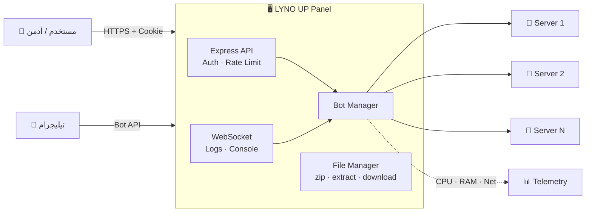
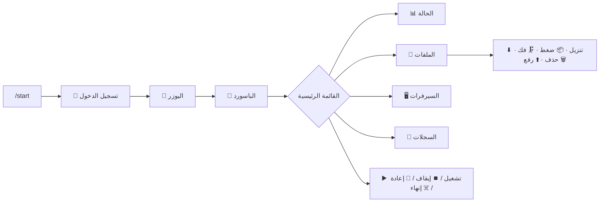

<div align="center">



<br/>


[](https://github.com/lyn0x-dev/LYNO_UP)
[](https://github.com/lyn0x-dev/LYNO_UP/stargazers)
[](https://github.com/lyn0x-dev/LYNO_UP/issues)

**لوحة تحكم كاملة متعددة المستخدمين لاستضافة وإدارة بوتات Node.js**
بواجهة داكنة عصرية على طراز Pterodactyl Arix — عربي RTL — بدون build.

[✨ المميزات](#-المميزات) · [🚀 التثبيت](#-التثبيت-في-دقيقة) · [⚙️ الإعدادات](#️-الإعدادات) · [🤖 تيليجرام](#-بوت-تيليجرام) · [🔌 API](#-api) · [🛡️ الأمان](#️-الأمان) · [🐙 GitHub](https://github.com/lyn0x-dev/LYNO_UP)


</div>

## 🎯 ليه LYNO UP؟

<table>
<tr>
<td width="25%" align="center"><h3>⚡</h3><b>تشغيل في دقيقة</b><br/><sub><code>npm install</code> ثم <code>npm start</code><br/>من غير build ولا إعدادات معقدة</sub></td>
<td width="25%" align="center"><h3>👥</h3><b>متعددة المستخدمين</b><br/><sub>كل حساب له سيرفرات معزولة<br/>والأدمن يدير الكل</sub></td>
<td width="25%" align="center"><h3>🔴</h3><b>كونسول مباشر</b><br/><sub>لوجات لحظية + أوامر تتبعت<br/>فعلياً لـ stdin</sub></td>
<td width="25%" align="center"><h3>🤖</h3><b>تحكم من تيليجرام</b><br/><sub>إدارة السيرفرات والملفات<br/>كلها بالأزرار</sub></td>
</tr>
</table>

<div align="center"></div>

## 🧭 نظرة عامة على المعمارية



<div align="center"></div>

## ✨ المميزات

### 🚀 إدارة السيرفرات

| الميزة | الوصف |
|:--|:--|
| ▶️ **تحكم كامل** | تشغيل / إيقاف / إعادة تشغيل / إنهاء قسري مع حالات مباشرة |
| ⌨️ **كونسول تفاعلي** | الأوامر بتتبعت فعلياً لـ stdin، واللوجات مباشرة عبر WebSocket محمي |
| ♻️ **إعادة تشغيل ذكية** | عند الانهيار، مع backoff تصاعدي وعدّاد محاولات لكل سيرفر |
| 📊 **قياسات حقيقية** | CPU والذاكرة لكل سيرفر (شجرة العمليات كاملة) + شبكة النظام |
| ⚙️ **متغيرات البيئة** | Environment Variables مستقلة لكل سيرفر |
| 📚 **تنصيب المكتبات** | `npm install` من `package.json` أو مكتبات محددة، والمخرجات في الكونسول |

### 📁 مدير الملفات

> على طراز Pterodactyl / Arix

```
 ➕ إنشاء مجلد/ملف     ✏️ تعديل       🔤 إعادة تسمية     🗑️ حذف
 ⬆️ رفع Drag & Drop    ⬇️ تنزيل ملف أو مجلد كـ .zip لحظياً
 📦 ضغط إلى .zip       🗜️ فك ضغط آمن (ضد zip-slip و zip-bomb)
```

### 👥 المستخدمون والصلاحيات

- 🛠️ **لوحة إدارة**: إنشاء / تعديل / إيقاف / حذف + تحديد الدور والحد الأقصى للسيرفرات
- 🎲 **بيانات عشوائية تلقائية**: أنشئ حساب بدون يوزر/باسورد والنظام يولّدهم ويعرضهم مرة واحدة (مع زر تصفير كلمة المرور)
- 🔑 **Subuser لكل سيرفر**: يوزر وباسورد عشوائي (زي `katapumb`)، ومن يدخل بيهم يشوف ويشغّل ذلك السيرفر فقط
- 🔗 **روابط مباشرة**:

| الرابط | بيعمل إيه |
|:--|:--|
| `/?u=username` | يفتح تسجيل الدخول باسم المستخدم جاهزاً |
| `/?server=id` | يفتح السيرفر فوراً بعد الدخول |

### 🎨 الواجهة

🌙 داكنة وحديثة &nbsp;·&nbsp; 📱 متجاوبة مع الجوال &nbsp;·&nbsp; 🔤 RTL عربي &nbsp;·&nbsp; 🌐 تعمل تلقائياً على دومين وبورت المنصة (`PORT` / `HOST`) &nbsp;·&nbsp; 🔥 تعديل CSS/JS/HTML يظهر فوراً **بدون ريستارت أو build**

<div align="center"></div>

## 🚀 التثبيت في دقيقة

```bash
# 1️⃣ تحميل المشروع
git clone https://github.com/lyn0x-dev/LYNO_UP.git
cd LYNO_UP

# 2️⃣ تثبيت الحزم
npm install

# 3️⃣ إعداد البيئة
cp .env.example .env          # ويندوز: copy .env.example .env
# افتح .env وعدّل ADMIN_USERNAME / ADMIN_PASSWORD

# 4️⃣ تشغيل
npm start                     # أو: npm run dev  للتطوير
```

افتح **`http://localhost:24691`** وسجّل الدخول بحساب الأدمن 🎉

> [!NOTE]
> **أول تشغيل:** بيتعمل حساب الأدمن تلقائياً من `.env`. لو `ADMIN_PASSWORD` فاضية هيتولّد باسورد عشوائي ويظهر في لوجات الخادم — انسخه وغيّره من صفحة "حسابي".

> [!IMPORTANT]
> لو `ADMIN_PASSWORD` موجودة في `.env` فهي **المصدر الرسمي** وبتتزامن مع **كل تشغيل**، فمش محتاج تمسح `users.json` لما تغيّرها. لو عايز تغيّر الباسورد من الواجهة باستمرار، سيبها فاضية.

### 🏭 الإنتاج مع PM2

```bash
npm install -g pm2
npm run pm2:start      # تشغيل
npm run pm2:restart    # إعادة تشغيل
npm run pm2:stop       # إيقاف
```

اللوحة بتسمع على `HOST` (افتراضياً `0.0.0.0`) فتكون متاحة على دومين المنصة وأي IP.

<div align="center"></div>

## ⚙️ الإعدادات

كل الإعدادات في ملف `.env` — اضغط على القسم اللي يهمك 👇

<details open>
<summary><b>🌐 الأساسيات</b></summary>
<br/>

| المتغير | الوصف | الافتراضي |
|:--|:--|:--|
| `PORT` | بورت اللوحة (غالباً تلقائي من المنصة) | `24691` |
| `HOST` | العنوان اللي اللوحة تسمع عليه | `0.0.0.0` |
| `PLATFORM_URL` | رابط الدومين المعروض في اللوحة | `https://lynox.duckdns.org/` |
| `ADMIN_USERNAME` | اسم مستخدم الأدمن الأول | `admin` |
| `ADMIN_PASSWORD` | كلمة مرور الأدمن (تتزامن كل تشغيل) | — |
| `DATA_DIR` | مجلد البيانات (لحفظها خارج الكود) | مجلد المشروع |
| `DISABLE_HTTPS` | `1` لقفل HTTPS على نفس البورت | — |

</details>

<details>
<summary><b>🔐 الجلسات والحدود</b></summary>
<br/>

| المتغير | الوصف | الافتراضي |
|:--|:--|:--|
| `SESSION_SECRET` | مفتاح توقيع الجلسات (لو فارغ يُحفظ في `.session_secret`) | — |
| `SESSION_TTL_HOURS` | مدة صلاحية الجلسة بالساعات | `168` (7 أيام) |
| `MAX_RUNNING_BOTS` | أقصى عدد سيرفرات شغالة معاً | `10` |
| `BOT_MEMORY_MB` | حد ذاكرة كل سيرفر (V8 heap) | `256` |
| `UPLOAD_MAX_MB` | أقصى حجم ملف مرفوع | `50` |
| `MAX_EXTRACT_MB` | أقصى حجم إجمالي بعد فك الضغط | `500` |

</details>

<details>
<summary><b>♻️ إعادة التشغيل التلقائي</b></summary>
<br/>

| المتغير | الوصف | الافتراضي |
|:--|:--|:--|
| `AUTO_RESTART_MAX` | أقصى محاولات متتالية (`0` = تعطيل) | `5` |
| `AUTO_RESTART_BASE_MS` | تأخير أول محاولة (يتضاعف حتى دقيقة) | `1000` |

</details>

<details>
<summary><b>🤖 تيليجرام</b></summary>
<br/>

| المتغير | الوصف | الافتراضي |
|:--|:--|:--|
| `TELEGRAM_BOT_TOKEN` | توكن من @BotFather (فاضي = معطّل) | — |
| `TELEGRAM_ALLOWED_IDS` | أرقام تيليجرام المسموحة (فاصلة/مسافة) | الكل |
| `TELEGRAM_API_BASE` | عنوان Telegram API بديل (للاختبار/Bot API محلي) | `https://api.telegram.org` |

</details>

<div align="center"></div>

## 🤖 بوت تيليجرام

ضع `TELEGRAM_BOT_TOKEN` في `.env` وشغّل اللوحة. كل شيء بالأزرار:



- زر **✖️ إلغاء** يظهر أثناء الرفع أو طلب باسورد الأرشيف أو تسجيل الدخول.
- 💡 لتقييد البوت لأشخاص محددين، حط أرقامهم في `TELEGRAM_ALLOWED_IDS`.

<div align="center"></div>

## 📝 مثال بوت

أنشئ سيرفر جديد وارفع ملف `index.js`:

```javascript
// index.js
const http = require('http');

http.createServer((req, res) => {
  res.end('Hello from my bot!');
}).listen(process.env.PORT || 8080, () => {
  console.log('Bot is running!');
});
```

<div align="center"></div>

## 📁 هيكل المشروع

```
bot-hosting-panel/
├── 🚪 index.js / server.js      نقطة الدخول (بتشغّل src/main.js)
├── 📦 package.json
├── 🔧 .env.example
├── 🧠 src/
│   ├── config.js               الإعدادات والحدود
│   ├── main.js                 HTTP/HTTPS + تيليجرام + الإغلاق الآمن
│   ├── app.js                  Express: middleware + routes + أخطاء
│   ├── auth.js                 الجلسات + تشفير كلمات المرور
│   ├── middleware.js           requireAuth / requireAdmin / صلاحيات السيرفرات
│   ├── store.js                users.json و bots.json
│   ├── accounts.js             حسابات السيرفر (Subuser)
│   ├── botManager.js           التشغيل/الإيقاف + اللوجات + إعادة التشغيل
│   ├── telemetry.js            CPU / الذاكرة / الشبكة
│   ├── ws.js · wsServer.js     WebSocket (لوجات + كونسول)
│   ├── uploads.js · tar.js · utils.js · bundle.js
│   └── routes/                 auth · users · bots · files · deps · system
├── 📚 lib/
│   ├── telegram.js             بوت التحكم
│   ├── archive.js              واجهة فك الضغط
│   └── archive-worker.js       7-Zip WASM داخل worker
├── 🎨 public/
│   ├── index.html
│   ├── css/                    01- ... 11-
│   └── js/                     01- ... 07-
├── 🧪 scripts/e2e.js           الاختبار الشامل
└── 💾 bots/ · bots.json · users.json   بيانات التشغيل (تلقائية)
```

<details>
<summary><b>✏️ عايز تعدّل إيه؟ روح فين؟</b></summary>
<br/>

| التعديل | الملف |
|:--|:--|
| الأرقام والحدود | `.env` (أو `src/config.js`) |
| اسم اللوحة | `BRAND_NAME` في `.env` + `<title>` و`SiteConfiguration` في `public/index.html` |
| الألوان والخطوط | `public/css/01-base.css` (قسم `:root`) |
| شاشة الدخول | `public/css/03-auth.css` + `11-auth-premium.css` |
| السايدبار والتوب بار | `public/css/04-layout-topbar.css` |
| كروت السيرفرات والداشبورد | `public/css/05-dashboard-servers.css` |
| صفحة السيرفر / الكونسول / الملفات | `public/css/06-server-view-files.css` |
| الموبايل (Responsive) | `public/css/10-responsive.css` |
| نصوص وأزرار الصفحات | `public/index.html` |
| تسجيل الدخول والتنقل | `public/js/02-auth-navigation.js` |
| قائمة السيرفرات والكونسول | `public/js/03-servers-console.js` |
| مدير الملفات | `public/js/04-file-manager.js` |
| إعدادات السيرفر وبيانات الدخول | `public/js/05-server-settings.js` |
| المستخدمين / النظام / الحساب | `public/js/06-admin.js` |
| التشغيل وإعادة التشغيل التلقائي | `src/botManager.js` |
| صلاحيات الوصول | `src/middleware.js` |
| API جديد | ملف جديد في `src/routes/` وسجّله في `src/app.js` |

> [!TIP]
> ملفات `public/` بتتجمّع تلقائياً وتتخدم كـ `/style.css` و`/app.js` — عدّل وحدّث الصفحة بدون ريستارت. الترتيب بالأرقام مهم (الأحدث يغلب الأقدم). أما `src/` فيحتاج ريستارت (أو `npm run dev`).

</details>

<div align="center"></div>

## 🔌 API

كل الـ Endpoints تحت `/api` وتحتاج كوكي الجلسة. علامة 🛡️ = للأدمن فقط.

<details>
<summary><b>🔐 المصادقة والمستخدمون</b></summary>
<br/>

| Method | Endpoint | الوصف |
|:--:|:--|:--|
| `POST` | `/api/auth/login` | تسجيل الدخول |
| `POST` | `/api/auth/logout` | تسجيل الخروج |
| `GET` | `/api/auth/me` | حالة المصادقة |
| `POST` | `/api/auth/password` | تغيير كلمة المرور |
| 🛡️ `GET` | `/api/users` | قائمة المستخدمين |
| 🛡️ `POST` | `/api/users` | إنشاء مستخدم (البيانات عشوائية لو فاضية) |
| 🛡️ `PUT` | `/api/users/:id` | تعديل (دور/حد/باسورد/إيقاف) |
| 🛡️ `POST` | `/api/users/:id/credentials` | توليد كلمة مرور جديدة |
| 🛡️ `DELETE` | `/api/users/:id` | حذف مستخدم + سيرفراته |

</details>

<details>
<summary><b>🖥️ السيرفرات</b></summary>
<br/>

| Method | Endpoint | الوصف |
|:--:|:--|:--|
| `GET` | `/api/bots` | السيرفرات (بتاعتك، أو الكل للأدمن) |
| `POST` | `/api/bots` | إنشاء سيرفر |
| `GET` | `/api/bots/:id` | تفاصيل سيرفر |
| `PUT` | `/api/bots/:id` | تحديث (حقول مُصرَّحة فقط) |
| `DELETE` | `/api/bots/:id` | حذف |
| `POST` | `/api/bots/:id/start` | تشغيل |
| `POST` | `/api/bots/:id/stop` | إيقاف |
| `POST` | `/api/bots/:id/restart` | إعادة تشغيل |
| `POST` | `/api/bots/:id/kill` | إنهاء قسري |
| `GET` | `/api/bots/:id/logs` | السجلات |
| `GET` | `/api/bots/:id/credentials` | يوزر السيرفر |
| `POST` | `/api/bots/:id/credentials` | توليد بيانات دخول جديدة |
| `POST` | `/api/bots/:id/install` | تنصيب مكتبات npm |

</details>

<details>
<summary><b>📁 الملفات</b></summary>
<br/>

| Method | Endpoint | الوصف |
|:--:|:--|:--|
| `GET` | `/api/bots/:id/files` | ملفات الجذر |
| `GET` | `/api/bots/:id/files/*` | قراءة ملف / تصفح مجلد |
| `PUT` | `/api/bots/:id/files/*` | تعديل ملف |
| `DELETE` | `/api/bots/:id/files/*` | حذف |
| `POST` | `/api/bots/:id/upload` | رفع ملف |
| `GET` | `/api/bots/:id/download/*` | تنزيل ملف (أو مجلد كـ zip) |
| `POST` | `/api/bots/:id/mkdir` | إنشاء مجلد |
| `POST` | `/api/bots/:id/newfile` | إنشاء ملف |
| `POST` | `/api/bots/:id/rename` | إعادة تسمية |
| `POST` | `/api/bots/:id/archive` | ضغط إلى `.zip` |
| `POST` | `/api/bots/:id/extract` | فك ضغط `.zip` |

</details>

<details>
<summary><b>🖧 النظام</b></summary>
<br/>

| Method | Endpoint | الوصف |
|:--:|:--|:--|
| `GET` | `/api/system` | معلومات النظام والحدود |
| `GET` | `/api/platform` | معلومات المنصة (بما فيها `panelUrl`) |

</details>

<div align="center"></div>

## 🛡️ الأمان

| | الحماية | التفاصيل |
|:--:|:--|:--|
| 🔐 | **مصادقة إجبارية** | على كل الـ API + WebSocket، جلسة موقّعة HMAC بصلاحية محدودة |
| 🔑 | **كلمات المرور** | مشفرة بـ scrypt (salt عشوائي) + منع timing/enumeration |
| 👤 | **عزل الملكية** | المستخدم يشوف سيرفراته، الأدمن الكل، والـ subuser سيرفره فقط |
| 🗜️ | **فك الضغط الآمن** | منع zip-slip + حد للحجم/عدد الملفات (zip-bomb) |
| 🚦 | **Rate Limiting** | 10 محاولات دخول/10 دقائق + 600 طلب API/دقيقة لكل IP |
| 📂 | **Path Traversal** | كل المسارات تُتحقق داخل مجلد السيرفر فقط |
| 🧹 | **الملفات المرفوعة** | تنظيف الأسماء ومنع الخروج عن المجلد |
| ✅ | **Whitelist للتحديث** | مستحيل تغيير `id`/`ownerId` أو إخراج `mainFile` |
| 🧪 | **عزل البيئة** | السيرفرات لا ترث أسرار اللوحة (زي `ADMIN_PASSWORD`) |
| 📉 | **حدود الموارد** | ذاكرة لكل سيرفر + حد للشغالة + حد للرفع + حد سيرفرات لكل مستخدم |
| 🧱 | **Security Headers** | CSP, X-Frame-Options, X-Content-Type-Options… |
| 🛑 | **آخر مشرف** | مستحيل تبقى اللوحة بدون مشرف شغال |

> [!WARNING]
> **للإنتاج:** استخدم HTTPS (عبر المنصة)، ولعزل كامل لملفات السيرفرات عن ملفات اللوحة استخدم Containers/Isolation.

<div align="center"></div>

## 🧪 الاختبار

```bash
npm test
```

يشغّل نسخة مؤقتة ببيانات مؤقتة ويفحص: الدخول، الصلاحيات، الـ WebSocket، الملفات، والأرشيفات.

<div align="center">


### 📄 الترخيص: [MIT](LICENSE)

صُنع بـ 💜 — **LYNO UP**

⭐ لو المشروع عجبك، [سيب نجمة على GitHub](https://github.com/lyn0x-dev/LYNO_UP)
🐛 لقيت مشكلة؟ [افتح Issue](https://github.com/lyn0x-dev/LYNO_UP/issues)

</div>
